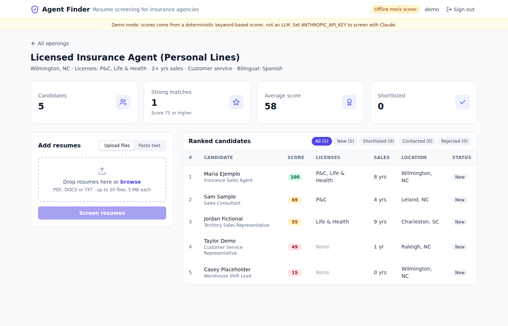
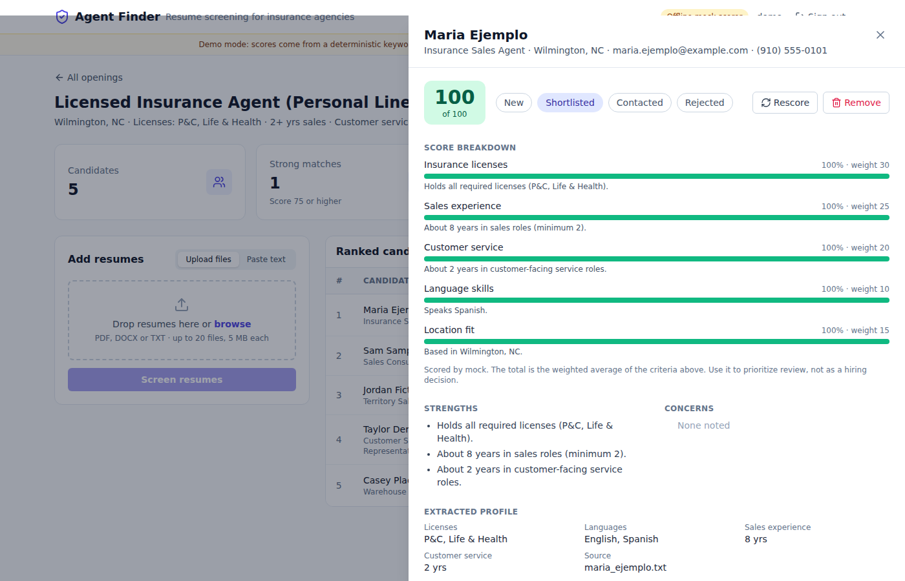
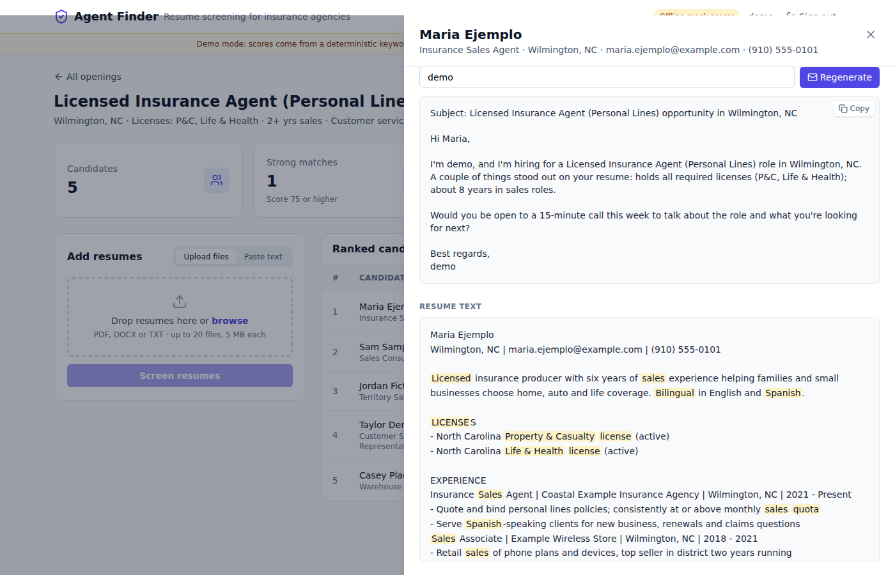

# Agent Finder

AI resume screening for insurance agency hiring. A recruiter creates an opening, uploads the resumes they
received, and gets a ranked shortlist where every score is broken down by criterion with the evidence behind it.



## What it does

- **Openings with explicit criteria.** Required licenses (P&C, Life & Health, Personal Lines, Series 6/7/63),
  minimum years in sales, customer service experience, preferred languages, location, and adjustable weights.
- **Resume intake.** Upload PDF, DOCX or TXT files (up to 20 at a time, 5 MB each) or paste resume text.
  Text is extracted on the server; scanned PDFs without a text layer are rejected with a clear message.
- **Structured extraction.** Name, contact details, location, current title, licenses, languages, and
  years of sales and customer service experience.
- **Explainable scoring.** Each criterion gets a 0 to 1 score and a one-sentence evidence note. The 0 to 100
  total is always computed by the server from the opening's weights, so rankings are consistent across providers.
- **Recruiter workflow.** Ranked table, status (new, shortlisted, contacted, rejected), notes, rescore after
  changing criteria, and the extracted resume text with relevant keywords highlighted.
- **Outreach drafts.** Generates a short personalized email draft to copy into your own mail client.
  Agent Finder never sends email.

| Candidate detail and score breakdown | Outreach draft and highlighted resume |
| --- | --- |
|  |  |

Screenshots are from demo mode with fictional resumes and the offline mock scorer.

### Responsible use

Scores are a way to prioritize reading, not a hiring decision. The LLM prompt tells the model to ignore
protected characteristics and to treat resume content as data rather than instructions, and every score
shows its evidence so a person can check it. There is no auto-reject. If you use this with real applicants,
review your local rules on automated employment decision tools (for example, NYC Local Law 144) and keep
a human in the loop.

## Scoring providers

| `LLM_PROVIDER` | What happens | Needs |
| --- | --- | --- |
| `anthropic` (default) | Claude (`claude-sonnet-5-5` by default) via the official `anthropic` SDK with structured outputs | `ANTHROPIC_API_KEY` |
| `openai` | OpenAI Chat Completions in JSON mode, validated against the same schema | `OPENAI_API_KEY` |
| `mock` | Deterministic regex and keyword scorer. No network calls. | nothing |

If the selected provider has no API key, the app falls back to `mock`, logs a warning, and shows an
"Offline mock scorer" badge and banner in the UI. `GET /api/health` reports the active provider.

The mock scorer is good enough to demo the workflow on conventionally formatted resumes. It is not a
substitute for an LLM on real-world resumes.

## Quick start (demo mode, no API key)

Requirements: Python 3.11+, Node 20+.

```bash
# Backend
cd backend
python -m venv .venv && source .venv/bin/activate
pip install -r requirements-dev.txt
DEMO_MODE=true uvicorn app.main:app --reload --port 8000

# Frontend (second terminal)
cd frontend
npm ci
npm run dev
```

Open http://localhost:5173 and sign in with `demo` / `demo-password`. Demo mode seeds one sample opening
(Wilmington, NC) with five fictional resumes from `backend/app/demo/resumes/`. All names, emails
(`@example.com`) and phone numbers (`555-01xx`) in those files are made up.

To screen with Claude instead, also set `ANTHROPIC_API_KEY` before starting the backend.

### Docker Compose

```bash
cp .env.example .env   # optionally add ANTHROPIC_API_KEY and SECRET_KEY
docker compose up --build
```

Frontend: http://localhost:3000, API: http://localhost:8000 (OpenAPI docs at `/docs`). The SQLite database
lives in the `backend_data` volume.

## Configuration

All settings are environment variables (the backend also reads `backend/.env`). See `.env.example`.

| Variable | Default | Notes |
| --- | --- | --- |
| `DEMO_MODE` | `false` (`true` in compose) | Seed the demo account, opening and fictional resumes on startup |
| `SECRET_KEY` | random per process | JWT signing key. Set it, or users are logged out on every restart |
| `LLM_PROVIDER` | `anthropic` | `anthropic`, `openai` or `mock` |
| `ANTHROPIC_API_KEY` | empty | Enables Claude |
| `ANTHROPIC_MODEL` | `claude-sonnet-5-5` | Any Claude model that supports structured outputs |
| `ANTHROPIC_EFFORT` | `medium` | `low`, `medium` or `high` |
| `OPENAI_API_KEY` / `OPENAI_MODEL` | empty / `gpt-4o-mini` | Optional OpenAI provider |
| `DATABASE_URL` | `sqlite:///./data/agent_finder.db` | Any SQLAlchemy URL |
| `LLM_CONCURRENCY` | `4` | Resumes screened in parallel per upload |
| `CORS_ORIGINS` | `http://localhost:3000,http://localhost:5173` | Comma separated |
| `VITE_API_BASE_URL` | `http://localhost:8000` | Frontend build-time API URL |

## Architecture

```
frontend/  React 18 + Vite + Tailwind, TanStack Query, Zustand (auth), axios
backend/   FastAPI + SQLAlchemy 2 (SQLite by default)
  app/api/          auth, jobs (openings), candidates (upload, list, detail, status, rescore, outreach)
  app/ai/rubric.py  criteria, weights and the weighted aggregation
  app/ai/providers.py  AnthropicProvider, OpenAIProvider, MockProvider behind one interface
  app/ai/prompts.py    screening and outreach prompts
  app/ai/extraction.py regex extraction used by the mock and to fill gaps in LLM output
  app/utils/        PDF/DOCX/TXT text extraction and upload validation
  app/demo/         demo seeding and fictional sample resumes
  tests/            pytest suite
```

Request flow for an upload: validate type and size, extract text, call the provider (up to
`LLM_CONCURRENCY` resumes in parallel), store the extracted profile and per-criterion results, compute the
weighted total, return the created candidates plus a per-file error list.

Tables are created on startup with `create_all`. There are no migrations yet, so schema changes currently
require recreating the database.

### API overview

| Method | Path | Purpose |
| --- | --- | --- |
| POST | `/api/auth/register`, `/api/auth/token` | Create account, get a bearer token |
| GET | `/api/auth/me` | Current user |
| GET, POST | `/api/jobs` | List or create openings |
| GET, PATCH, DELETE | `/api/jobs/{id}` | Read, update criteria, delete |
| POST | `/api/jobs/{id}/candidates/upload` | Multipart upload of resumes (`files`) |
| POST | `/api/jobs/{id}/candidates/text` | Screen pasted text |
| GET | `/api/jobs/{id}/candidates?status=&min_score=` | Ranked candidates |
| GET, PATCH, DELETE | `/api/candidates/{id}` | Detail, update status/notes, delete |
| POST | `/api/candidates/{id}/rescore` | Re-run screening |
| POST | `/api/candidates/{id}/outreach` | Generate an email draft |
| GET | `/api/health` | Status, active provider, demo mode |

## Development

```bash
# Backend
cd backend
ruff check . && ruff format --check .
pytest -q

# Frontend
cd frontend
npm run lint
npm run build
```

The test suite covers registration and login, upload and parsing of TXT, PDF and DOCX, validation errors,
the rubric math, mock scoring and ranking, status and notes, per-user isolation, outreach drafts, and the
Claude and OpenAI providers using fake clients (no network, no API keys). CI runs the same commands on
every push and pull request, plus `docker compose config`.

## Status

Working: everything listed under "What it does", in demo mode and with an API key.

Not yet implemented:

- Database migrations (Alembic)
- Storing the original uploaded files (only extracted text is kept)
- OCR for scanned PDFs
- Teams or shared openings (each account sees only its own openings)
- Background processing for large batches (uploads are screened within the request)

History: this repository started as a LinkedIn/Indeed scraper with bulk cold email. That approach was
dropped because scraping those sites and automated mass outreach violate their terms of service; the
scraper, proxy and SMTP code has been removed.

## License

No license has been chosen yet, so default copyright applies. Add a `LICENSE` file before reusing the code.
